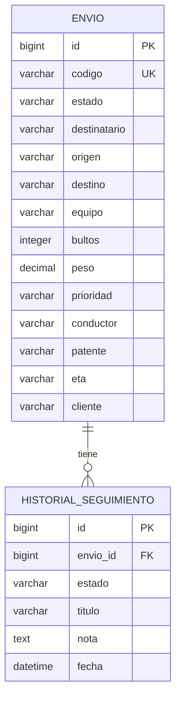

# Music Pro Courier · Proyecto semestral

Portal  de Transporte y Despachos, construido con Django, HTML semántico, Bootstrap y CSS propio. Conserva el diseño del portal y presenta ocho envíos ficticios leídos desde un archivo JSON.

## Evaluación 2 · Paso 1: modelos y migración inicial

La conexión usa **SQLite**, configurada en `bibliotecainacap/bibliotecainacap/settings.py`.
El archivo local es `bibliotecainacap/db.sqlite3`; se puede abrir con la extensión SQLite DB Viewer.

Se agregaron dos modelos en `core/models.py`:

- **Envio:** contiene los datos de un despacho, como código único, destinatario, carga y estado.
- **HistorialSeguimiento:** contiene los eventos de un envío, con estado, título, nota y fecha.

Un envío puede tener varios eventos. La relación se define con `ForeignKey` y `related_name="historial"`. Al eliminar un envío mediante Django, `on_delete=models.CASCADE` elimina también sus eventos. Django crea automáticamente la clave primaria `id` de cada modelo. `__str__` define el texto legible de cada registro.



La migración `core/migrations/0001_initial.py` crea las tablas `core_envio` y `core_historialseguimiento`. Fue generada por Django y aplicada a la base local.

```powershell
# Generar archivos cuando se crean o modifican modelos:
.\venv\Scripts\python.exe bibliotecainacap\manage.py makemigrations core
# Aplicar las migraciones existentes a la base local:
.\venv\Scripts\python.exe bibliotecainacap\manage.py migrate
# Comprobar cuáles están aplicadas; [X] indica aplicada:
.\venv\Scripts\python.exe bibliotecainacap\manage.py showmigrations core
```

El archivo SQLite no se publica en GitHub: se reconstruye con las migraciones. La interfaz de U1 todavía consulta los ejemplos JSON.

## Evaluación 2 · Paso 2: Django Admin

El administrador está disponible en **http://127.0.0.1:8000/admin/** y requiere una cuenta de administrador. Los modelos se registran y configuran en `core/admin.py`.

| Modelo | Columnas del listado | Filtros | Búsqueda |
|---|---|---|---|
| Envío | Código, destinatario, estado, prioridad y cliente | Estado y prioridad | Código, destinatario y correo del cliente |
| Historial de seguimiento | Envío, estado, título y fecha | Estado | Código del envío y título |

Cada listado muestra 25 registros por página. Al crear un evento de seguimiento, el campo de envío permite buscar por código. El administrador tiene el título Music Pro Courier y agrupa los modelos bajo Transporte y despachos.

Para crear una cuenta en otra instalación, después de ejecutar `migrate`:

```powershell
.\venv\Scripts\python.exe bibliotecainacap\manage.py createsuperuser
```

El comando solicita el nombre de usuario, el correo y una contraseña. Las cuentas y contraseñas locales no se incluyen en el repositorio. Django guarda las contraseñas mediante hashes.

Para demostrar el funcionamiento:

1. Entra a `/admin/` con tu cuenta.
2. En **Envíos**, presiona **Añadir** y completa los datos del despacho.
3. Consulta el registro creado, modifica un campo y guarda.
4. En **Historial de seguimiento**, añade un evento y selecciona el envío mediante la búsqueda.
5. Usa los filtros y la barra de búsqueda para encontrar registros.
6. Abre un registro de prueba y usa **Eliminar**, revisando la confirmación antes de borrarlo.

Estas operaciones sí guardan los cambios en SQLite. Puedes comprobarlos abriendo `db.sqlite3` con SQLite DB Viewer. El estado actual del envío y sus eventos se administran de forma explícita: cambiar el estado no crea automáticamente un evento.

`settings.py` habilita las aplicaciones, sesiones, permisos y mensajes que necesita Django Admin; la ruta `/admin/` se declara en el `urls.py` del proyecto. Las migraciones de Django crean sus tablas de usuarios, permisos, sesiones y registro de acciones, además de las dos tablas de nuestros modelos.

**Estado de este paso:** administrador funcional y acceso local verificado. La carga de datos ficticios con Faker queda para el siguiente avance. El panel `/panel/` sigue siendo la demostración JSON de U1.

## Iniciar en este computador

Abre la terminal de Visual Studio Code en la carpeta del proyecto y ejecuta:

```powershell
.\venv\Scripts\python.exe bibliotecainacap\manage.py runserver 127.0.0.1:8000 --noreload
```

Abre **http://127.0.0.1:8000/**. Mantén abierta la terminal; `Ctrl+C` detiene el servidor.Si modificas Python, detén y vuelve a iniciar el servidor.

Para instalar en otro equipo con Python 3.12 o superior:

```powershell
python -m venv venv
.\venv\Scripts\python.exe -m pip install -r requirements.txt
.\venv\Scripts\python.exe bibliotecainacap\manage.py migrate
.\venv\Scripts\python.exe bibliotecainacap\manage.py runserver
```


Explicacion


1. Abre el inicio y presiona **Ingresar al portal**. Puedes dejar los campos vacíos: son visuales y no se validan credenciales.
2. En el panel muestra los cuatro contadores, la tabla, los filtros y la segunda página de resultados.
3. Busca `MP-2026-001` y explica sus etapas e historial. `MP-2026-004` es un ejemplo recibido.
4. Usa **Nuevo envío**, completa datos ficticios y muestra su vista previa.
5. Abre un envío en curso y usa **Actualizar estado** para ver cómo quedaría la siguiente etapa.
6. Vuelve al panel: los ocho ejemplos originales permanecen iguales. Ninguna de las dos acciones guarda cambios.
7. Exporta los resultados filtrados en JSON.

El registro también es visual: envía un formulario y muestra una confirmación, pero no crea cuentas. Las fechas, personas y direcciones son ficticias; no hay GPS ni integración con entregas reales.


**Framework CSS de esta versión:** Bootstrap local, junto a `portal.css`. La versión actual no carga Tailwind. Se conserva este diseño en la corrección.

## Archivos principales

```text
bibliotecainacap/
  manage.py
  bibliotecainacap/
    settings.py
    urls.py
  core/
    urls.py
    views.py
    services.py
    models.py
    admin.py
    migrations/0001_initial.py
    tests.py
    data/envios.json
    templates/core/
      iniciar_sesion.html
      registro_usuario.html
      panel_envios.html
      buscar_envio.html
      detalle_envio.html
      nuevo_envio.html
      actualizar_estado.html
      ayuda.html
      error.html
    static/core/
      portal.css
      portal.js
      concierto.jpg
      favicon.svg
      vendor/
```

## Verificación y avances

```powershell
.\venv\Scripts\python.exe bibliotecainacap\manage.py check
.\venv\Scripts\python.exe bibliotecainacap\manage.py test core
```

Las pruebas de modelos verifican el guardado, consulta, modificación, eliminación, código único y relación del historial. Se ejecutan en una base de prueba independiente, sin llenar ni modificar los registros de la base local.
Las pruebas del administrador verifican el acceso, permisos, operaciones CRUD de ambos modelos, búsquedas, filtros, selección del envío y rechazo de datos inválidos.

