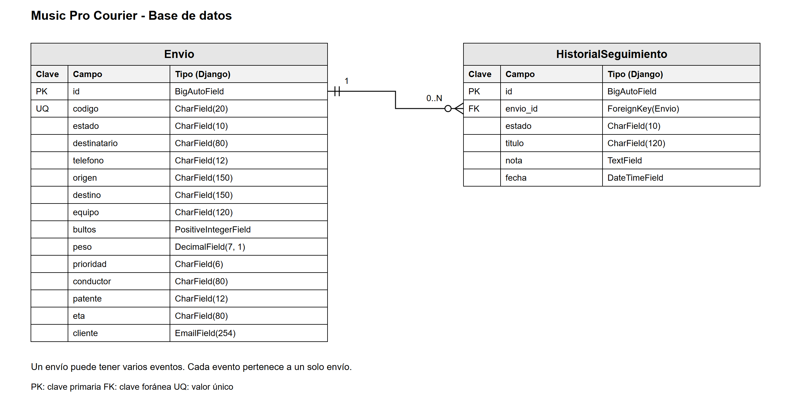

# Music Pro Courier

Proyecto Django de Transporte y Despachos para la Evaluación 2.
Usa SQLite, dos modelos relacionados, migraciones, Django Admin y Faker.

## Iniciar la página

Desde la carpeta principal del proyecto:

```powershell
.\venv\Scripts\activate
cd .\bibliotecainacap
python manage.py runserver 127.0.0.1:8000
```

- Página: http://127.0.0.1:8000/
- Administrador: http://127.0.0.1:8000/admin/
- Para detener el servidor: `Ctrl+C`.

El administrador se abre directamente usando el superadministrador existente.
`core/middleware.py` hace esto únicamente con `DEBUG=True` y una conexión local
(`127.0.0.1` o `::1`). No elimina la contraseña guardada de la cuenta.
Con `DEBUG=False` o desde otra dirección, Django solicita el inicio de sesión.
Esta configuración es para la presentación local.

## Base de datos y modelos

La conexión está en `bibliotecainacap/settings.py` y el archivo es `db.sqlite3`.
Puedes abrirlo con SQLite DB Viewer.

Los modelos están en `core/models.py`:

- **Envio:** código único, estado, destinatario, origen, destino, equipo, bultos,
  peso, prioridad, conductor, patente, estimación de entrega y correo del cliente.
- **HistorialSeguimiento:** envío, estado, título, nota y fecha del evento.

Django crea la clave primaria `id` de cada modelo. `ForeignKey` relaciona cada
evento con un envío; un envío puede tener varios eventos. `CASCADE` elimina sus
eventos cuando se elimina el envío mediante Django. `__str__` define el texto con
que aparece el registro. Los validadores impiden bultos o pesos menores al mínimo.



[PNG para entregar](diagrama_base_datos.png) · [SVG editable](diagrama_base_datos.svg)

## Migraciones

- `0001_initial`: crea las tablas de envíos e historial y su relación.
- `0002_indexar_fecha_historial`: agrega un índice a `fecha` para consultar los
  últimos eventos sin ordenar toda la tabla cuando hay muchos registros.

Desde la carpeta que contiene `manage.py`:

```powershell
python manage.py makemigrations
python manage.py migrate
python manage.py showmigrations
```

`makemigrations` genera los archivos de cambios; `migrate` los aplica a SQLite;
`showmigrations` muestra con `[X]` los que ya están aplicados.
Las migraciones de `admin`, `auth`, `contenttypes` y `sessions` vienen con Django.

## Django Admin

`core/admin.py` registra los dos modelos y configura:

- `list_display`: columnas del listado.
- `list_filter`: filtros por estado y, en envíos, prioridad.
- `search_fields`: campos de búsqueda.
- `ordering`: orden de los registros.
- `list_per_page`: 25 registros por página.
- `autocomplete_fields`: búsqueda del envío al añadir un evento, sin cargar un
  desplegable con un millón de opciones.
- `list_select_related`: consulta el evento y su envío juntos.

Para demostrar CRUD: añade un envío, búscalo, modifica un campo y elimínalo.
También puedes añadir, consultar, modificar y eliminar eventos de seguimiento.
Comprueba los cambios en SQLite DB Viewer. Cambiar el estado de un envío no crea
un evento automáticamente: ambos registros se administran explícitamente.

## Datos ficticios con Faker

El comando está en `core/management/commands/generar_datos.py`.
Ejecuta la cantidad que pida el profesor:

```powershell
python manage.py generar_datos 100
python manage.py generar_datos 1000
python manage.py generar_datos 100000
python manage.py generar_datos 1000000
```

Cada ejecución agrega envíos y entre uno y cuatro eventos por envío; conserva los
registros anteriores. El comando muestra los totales guardados y un código de ejemplo.

Faker genera nombres y direcciones con `es_CL`. Se reutilizan hasta 1.000 destinos
y 20 conductores. Los códigos llevan un identificador de carga para evitar repetidos.
`bulk_create` guarda por lotes de 1.000 para limitar la memoria.
`transaction.atomic()` revierte la carga si ocurre un error. Al terminar se cuentan
los registros de esa carga para verificar que se guardaron correctamente.
Las cuatro cantidades se probaron en una base temporal separada de la base local.

Para consultar los totales en SQLite DB Viewer:

```sql
SELECT COUNT(*) FROM core_envio;
SELECT COUNT(*) FROM core_historialseguimiento;
```

## Interfaz de la Unidad 1

Las páginas originales conservan los ocho ejemplos de `core/data/envios.json`.
Sus formularios de acceso y registro son visuales. Crear un envío o actualizar su
estado muestra una vista previa. Los cambios reales de la Unidad 2 se realizan
en Django Admin y se guardan en SQLite. El diseño usa Bootstrap y CSS propio.

## Archivos para explicar

| Archivo | Función |
|---|---|
| `bibliotecainacap/settings.py` | Configura Django y SQLite. |
| `bibliotecainacap/urls.py` | Conecta `/admin/` y las rutas del portal. |
| `core/models.py` | Define los datos y su relación. |
| `core/migrations/` | Conserva los cambios de la estructura. |
| `core/admin.py` | Configura la administración de los registros. |
| `core/middleware.py` | Permite el acceso directo al Admin en la presentación local. |
| `core/management/commands/generar_datos.py` | Genera y guarda datos con Faker. |
| `core/urls.py` y `core/views.py` | Rutas y vistas HTML de la Unidad 1. |
| `core/services.py` | Lee y filtra los ejemplos JSON de la Unidad 1. |

## Instalar en otro computador

Desde la carpeta principal, con Python 3.12 o superior:

```powershell
python -m venv venv
.\venv\Scripts\activate
pip install -r requirements.txt
cd .\bibliotecainacap
python manage.py migrate
python manage.py createsuperuser
python manage.py generar_datos 100
python manage.py runserver 127.0.0.1:8000
```

El superusuario debe existir para que funcione el acceso directo local.
La base SQLite, las cuentas y las contraseñas no se publican en GitHub.

## Comprobar el proyecto

Desde la carpeta que contiene `manage.py`:

```powershell
python manage.py check
python manage.py test core
```

Las pruebas comprueban la navegación, los modelos, CRUD desde Admin, acceso local
y generación de datos. Usan una base de prueba independiente de la base local.
